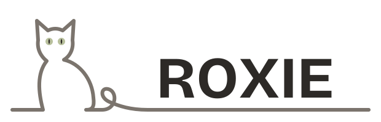

<picture>
  <source media="(prefers-color-scheme: dark)" srcset="docs/logo/roxie-wordmark-dark.svg">
  
</picture>

ROXIE: Ranked Objects eXtended Index Engine. A log collector written in Hilde on Wolly

Website: https://hilde-lang.org/wolly/

# ROXIE

ROXIE = Ranked Objects eXtended Index Engine

A log collector for a handful of hosts, written in
[Hilde](https://github.com/heikozim/hilde) on
[Wolly](https://github.com/heikozim/hilde-wolly).

## What it does

An **agent** on each host reads the new lines of its log files
(Wolly.LogTail), reads their time and level from them where it can
(Roxie.Line: syslog in RFC 3339 and BSD form, Hiawatha; the level also from
a priority, a JSON or logfmt field) and guesses the level of the rest, and
sends them in numbered batches to the **collector** over HTTPS with the
client certificate and the token of its host.  The agent confines itself
(pledge and unveil on OpenBSD, Landlock and seccomp on Linux).

The collector runs as a FastCGI application behind Hiawatha: it keeps the
lines (Wolly.LogStore, full-text search with FTS5), counts them
(Wolly.Metrics) and shows them on a dashboard (Wolly.Dashboard) with a
search field for the query language of Wolly.Query:

    host:server and level:error and time:last 24h and "mariadb"

The pages are drawn on the server; the only script is htmx, served by ROXIE
itself.  Sign-in goes through an OpenID Connect provider.  The query
language, its JSON output and the reader API are described in
`docs/syntax.md`.

## Commands

    roxie                      the collector, a FastCGI responder on /run/roxie/roxie.sock
                               (--socket or ROXIE_SOCKET for another)
    roxie serve SOCKET         the same on the socket SOCKET (an absolute path)
    roxie allow NAME SUB       the account SUB of the provider signs in as the user NAME
    roxie revoke-user NAME     no account signs in as NAME any more
    roxie token HOST           a token for the agent of HOST, shown once
    roxie revoke HOST          revokes the tokens of HOST
    roxie reader NAME          a token for the reader NAME (GET /api/query), shown once
    roxie revoke-reader NAME   revokes the tokens of the reader NAME
    roxie agent CONFIG         the agent, a round every few seconds until SIGTERM
    roxie agent-once CONFIG    one round of the agent
    roxie prune DAYS           takes lines and samples older than DAYS days out of the store
    roxie relevel              gives every kept line the level of today's rules
    roxie query QUERY...       the lines QUERY finds, newest first; --json, --limit N, --since SINCE
    roxie doctor               checks the files of the collector in the working directory and its socket
    roxie info                 the banner, the name, the version, the build, the system
    roxie version [--full]     the version from the tag of the build; -V, --version
    roxie -s                   what confines the process
    roxie setup completion bash|zsh|fish, roxie setup manual
                               the completion of a shell, the manual page in mdoc

The collector works in its working directory (`roxie.db`, `csrf.key`,
`pseudonym.key`, `audit.log`, `access.log`, `known-passwords.txt` from
`share/`, `rambo.conf` and `rambo-secret` of the sign-in).  Hiawatha in front
of it needs `HTTPAuthToCGI = yes` (the token of `/ingest`) and a
`MaxRequestSize` of at least 1100 (KB), as in `scripts/in-e2e.sh`.

## Build and test

Inside the build container of Wolly, with a Wolly tree beside this one:

    make build WOLLY_ROOT=../hilde-wolly
    make test  WOLLY_ROOT=../hilde-wolly

`make test` runs the unit tests, the contract tests, the contract lint, the
build and the end-to-end test behind Hiawatha (`scripts/in-gate.sh`).

## Licence

Copyright (c) 2026 Heiko Zimmermann <code@heiko-zimmermann.com>

ROXIE is licensed under the Apache License 2.0 with LLVM exception; see
LICENSE.  `share/htmx.min.js` is htmx, Zero-Clause BSD; see NOTICE.
